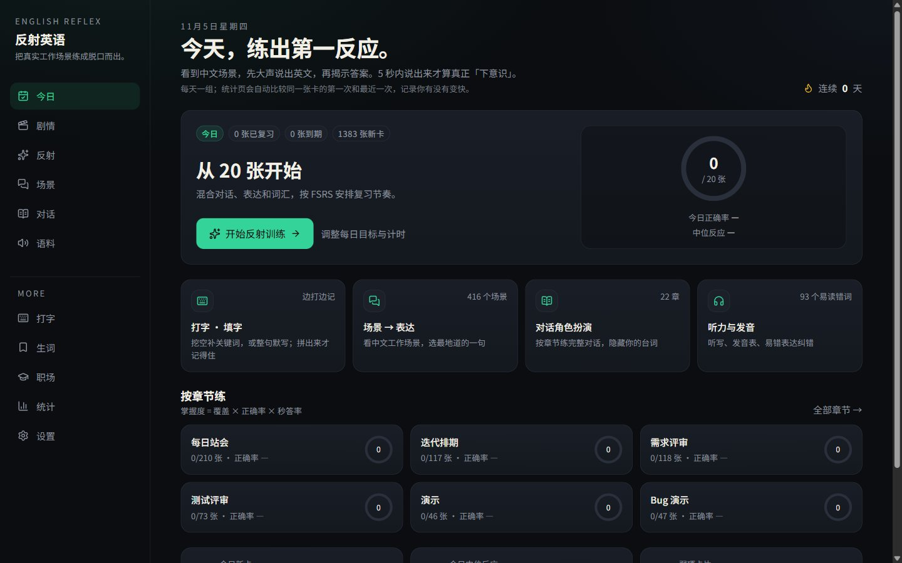
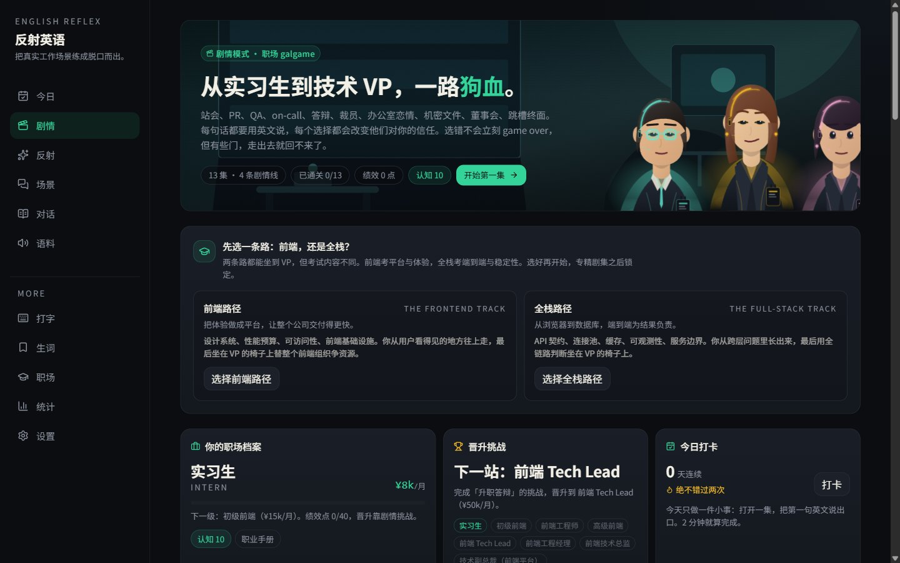
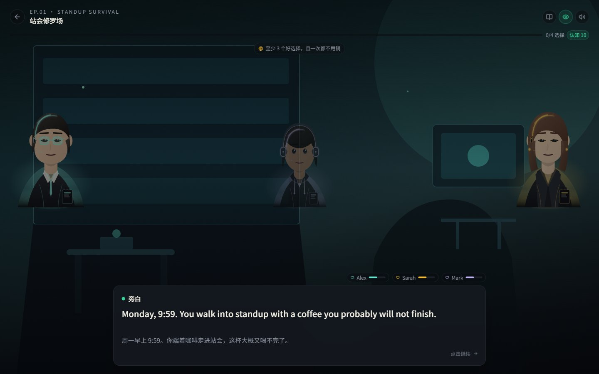
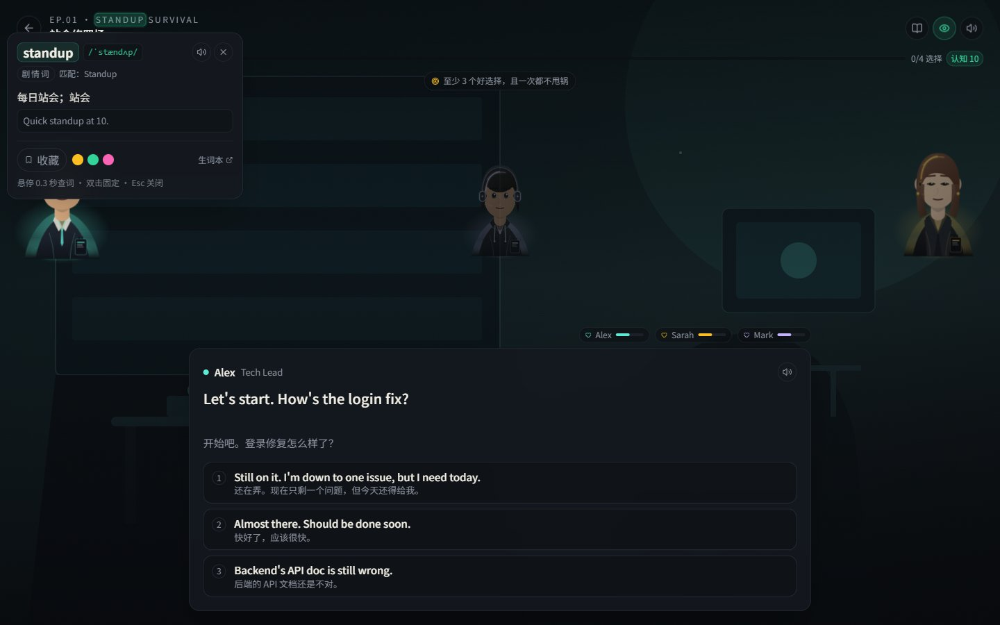
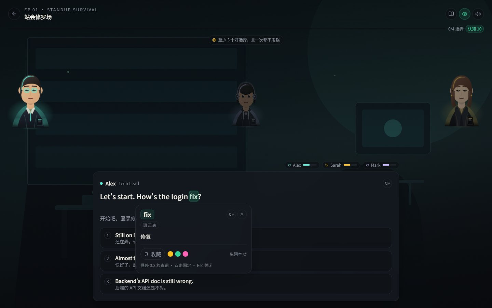
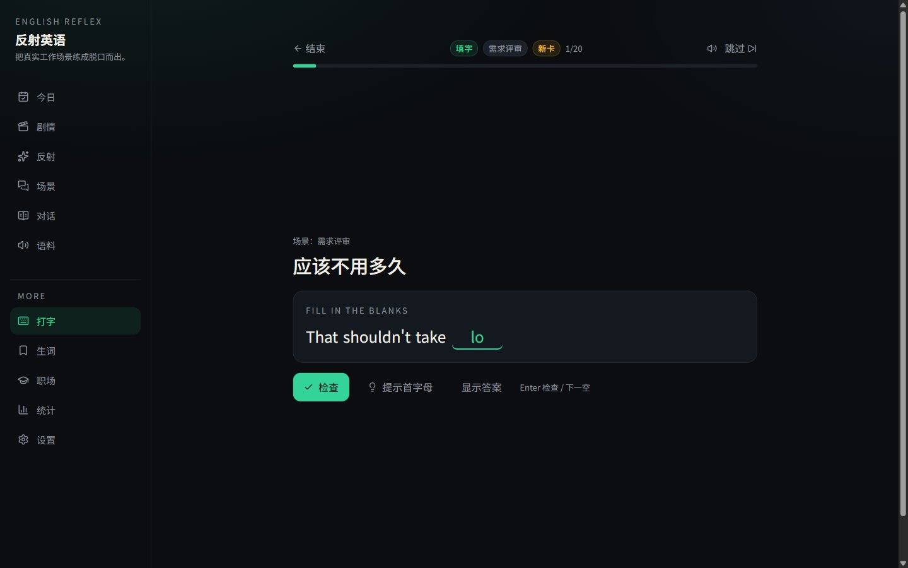
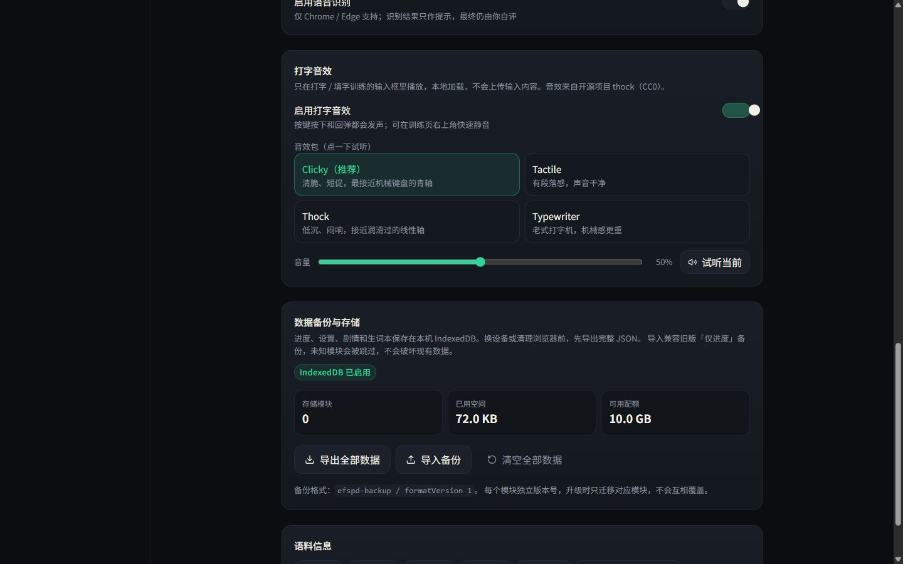

# 反射英语 · Web Trainer

把本仓库的 Markdown 语料变成一个可安装的英语反射训练应用：看到中文工作场景，限时说出地道英文，用间隔重复把「想起来」练成「脱口而出」。

- 在线体验：<https://0x1428571429.github.io/English-for-Software-Product-Development/>
- 语料来源：仓库根目录 `frontend-engineer/` 与 `scripts/dialogue_data.json`



## 界面

| 剧情大厅 | 赛博朋克剧情场景 | 选择与角色信任 |
| --- | --- | --- |
|  |  |  |

| 悬停 / 双击查词 | 打字 · 填字 | 打字音效设置 |
| --- | --- | --- |
|  |  |  |

## 训练方式

1. **限时反射训练（中 → 英）**：默认 5 秒倒计时，先开口再揭示；记录每题反应时间，由 FSRS 安排下次复习。
2. **打字 · 填字**：英文句子挖空 1–3 个关键词，或只看中文整句默写；逐空校验、首字母提示、逐词差异，拼写过程帮助记忆。可配 4 套 CC0 机械键盘音效（默认清脆的 Clicky），只在输入框发声，设置页可试听和调音量。
3. **场景 → 表达**：从 416 条真实工作场景里选最自然的一句，训练情境识别。
4. **对话角色扮演 / 跟读**：22 章对话可阅读、角色隐藏、整段播放。
5. **听力与发音**：TTS 听写、易错词发音表、常见中式错误纠错。
6. **职场 galgame**：13 集、4 条剧情线（晋升 / 管理 / 暗线 / 跳槽）。固定角色、赛博朋克头像、信任值、认知门槛、三种结局、挑战与升职加薪；可以选前端或全栈路径一路坐到 VP，也可以深夜打开不该看的文件，被公司开除。
7. **职业手册 + 汇报训练**：剧情里解锁设计系统、连接池、事故汇报、信息分级等知识卡；汇报训练提供结论先行 / SCQA / STAR / 事故汇报四种框架，填四段就能生成英文汇报。
8. **全局查词 + 生词本**：鼠标在英文单词上停 0.3 秒，单词会以 tag 高亮并弹出释义、音标、例句；双击固定卡片并取消原生选中。支持收藏和颜色标记，生词本统一管理。
9. **统计与训练实验**：每日目标、连续天数、12 周热力图、中位反应时间、章节掌握度；并自动比较同一张卡「第一次 vs 最近一次」的反应时间与正确率（单组前后测）。

进度、剧情、设置、生词都保存在浏览器 IndexedDB，设置页可统一导出 / 导入 JSON，无后端。

## 发音引擎

系统只有中文语音时，直接用浏览器朗读英文会非常生硬。设置页提供：

- **自动（推荐）**：有 Edge / Chrome 的自然英文音色就用系统；配置了 Edge 代理时用 Edge，否则用百度在线 TTS。
- **在线 · Edge Natural**：微软 Edge 朗读同款自然音色，免费。浏览器直连会被握手校验拦截（403），需要先运行 `npm run tts:proxy`，再把设置里的「Edge 代理地址」填成 `http://127.0.0.1:8787`；合成过的句子会缓存在 IndexedDB。属于非官方接口，失败会自动回退。
- **在线 · 百度**：国内可直接访问，支持完整句子。
- **在线 · Google**：音色更自然，但需要能访问 Google。
- **系统音色**：使用已安装的英文语音包（Edge 的 Natural 音色效果最好）。

在线音色都走浏览器 `<audio>`，不需要 API key；断网时自动退回系统音色。发音页的单个单词优先使用有道词典的单词发音，失败时再回退到所选引擎。TTS 选型、Edge 逆向协议与代理部署细节见 [`docs/TTS.md`](docs/TTS.md)。

## 剧情模式

- **固定角色**：Alex、Sarah、Mark、Lisa、Tom、Diana、Nina、Kevin、Victor，每个人都有固定长相、立场和说话方式。头像由 face / eyes / outfit / accessory 四个部件程序化拼成，赛博朋克风格，构建期由 `npm run cast` 校验唯一性。
- **路径选择**：开局选择前端或全栈。两条路径有不同的专精剧集、职级称谓和 VP 挑战；进入专精线后锁定。
- **认知系统**：初始认知 10。做出成熟的选择会永久增加认知，后续剧集里需要认知门槛的选项才会解锁；重玩不重复刷认知。
- **信任与结局**：每个选择影响角色信任；好 / 普通 / 坏三种结局，部分剧集有「被开除」结局。被开除不删档，可以重玩改写。
- **知识卡**：管理线、专精线和暗线剧集带职业知识卡，通关后进入 `/career` 职业手册。

## 本地开发

```bash
cd web
npm install
npm run dev        # 构建语料 / 词表 / 角色 + 启动 Vite
```

常用脚本：

```bash
npm run data       # 重新解析 Markdown，生成 src/data/corpus.generated.json
npm run words      # 生成 src/data/word-map.generated.json（全局查词）
npm run cast       # 校验固定角色头像并生成 public/cast/manifest.json
npm run typecheck  # tsc -b
npm run lint       # oxlint
npm run test       # vitest（含剧情图可达性、两条路径通关模拟）
npm run build      # 构建到 dist/
npm run preview    # 预览生产构建
npm run tts:proxy  # 本地 Edge TTS 代理（可选，默认 127.0.0.1:8787）
```

要求 Node 22+。语料、词表、角色 manifest 在构建时生成，不提交到 git。架构与扩展方式见 [`docs/ARCHITECTURE.md`](docs/ARCHITECTURE.md)，模块约定见 [`src/features/README.md`](src/features/README.md)，TTS 选型见 [`docs/TTS.md`](docs/TTS.md)，打字音效来源与许可证见 [`docs/SOUND.md`](docs/SOUND.md)，需求任务板见 [`docs/BACKLOG.md`](docs/BACKLOG.md)，发布前测试清单见 [`docs/QA.md`](docs/QA.md)。

## 部署

推送到 `main` 后，`.github/workflows/deploy-web.yml` 会自动构建并部署到 GitHub Pages（Source 选择 GitHub Actions）。也可在 Actions 页面手动触发 `workflow_dispatch`。

Vite 使用 `base: './'` + `HashRouter`，因此项目页子路径和 PWA 离线缓存都能正常工作。

## 数据管道

`scripts/build-corpus.mjs` 解析：

- `frontend-engineer/NN-*/01-dialogue.md` 三种对话格式（`> A:`、`> User:`、Slack 聊天）
- 表达解析文件（`Also say` / `还可以说` / 关联对话 / 使用场景）
- `*vocab.md`、`*pronunciation.md`
- `reference/high-frequency-expressions.md`、`common-mistakes.md`、`scenarios-brainstorm.md`

构建会打印逐章翻译覆盖率并把统计写入 `src/data/corpus.report.json`。没有中文翻译的补充例句不会生成「中 → 英」卡片，避免把不相关的句子配成一张卡。

## 声明

在线 TTS 使用第三方公开接口，仅用于个人学习；接口不可用时请切换到其他引擎或系统音色。语料版权归原仓库作者所有。
